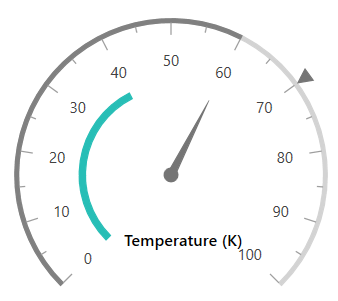

# Getting Started with WPF Circular Gauge (SfCircularGauge)

This sample demonstrates how to create and configure a [Syncfusion WPF Circular Gauge (SfCircularGauge)](https://www.syncfusion.com/wpf-controls/radial-gauge) with headers, scales, ranges, and various pointer types.

## Table of Contents

- [Adding Gauge Reference](#adding-gauge-reference)
- [Initialize Gauge](#initialize-gauge)
- [Add Header](#add-header)
- [Configure Scales](#configure-scales)
- [Add Ranges](#add-ranges)
- [Add Pointers](#add-pointers)
- [Output](#output)

---

## Adding Gauge Reference

Install the **Syncfusion.SfGauge.WPF** NuGet package into your WPF project.

**Package Reference in `.csproj`:**

```xml
<ItemGroup>
    <PackageReference Include="Syncfusion.SfGauge.WPF" Version="*" />
</ItemGroup>
```

---

## Initialize Gauge

Import the WPF Circular Gauge namespace in your `MainWindow.xaml`:

```xml
xmlns:gauge="clr-namespace:Syncfusion.UI.Xaml.Gauges;assembly=Syncfusion.SfGauge.Wpf"
```

Then initialize an empty `SfCircularGauge` as shown below:

```xml
<gauge:SfCircularGauge />
```

---

## Add Header

You can assign a unique header to the `SfCircularGauge` by using the `GaugeHeader` property:

```xml
<gauge:SfCircularGauge Height="250"
                       Width="250"
                       HeaderAlignment="Custom"
                       GaugeHeaderPosition="0.63,0.75">
    <gauge:SfCircularGauge.GaugeHeader>
        <TextBlock Text="Speedometer"
                   Height="40"
                   Width="140"
                   FontSize="13"
                   Foreground="Black"
                   FontWeight="SemiBold" />
    </gauge:SfCircularGauge.GaugeHeader>
</gauge:SfCircularGauge>
```

---

## Configure Scales

You can configure the `CircularScale` elements:

```xml
<gauge:SfCircularGauge.Scales>
    <gauge:CircularScale ShowRim="True"
                         RimStroke="LightGray"
                         RimStrokeThickness="3"
                         LabelOffset="0.1">
        
        <gauge:CircularScale.MajorTickSettings>
            <gauge:MajorTickSetting Length="10"
                                    StrokeThickness="1" />
        </gauge:CircularScale.MajorTickSettings>
        
        <gauge:CircularScale.MinorTickSettings>
            <gauge:MinorTickSetting Length="5"
                                    StrokeThickness="1" />
        </gauge:CircularScale.MinorTickSettings>
    </gauge:CircularScale>
</gauge:SfCircularGauge.Scales>
```

---

## Add Ranges

You can add ranges to the `SfCircularGauge`:

```xml
<gauge:CircularScale.Ranges>
    <gauge:CircularRange StartValue="0"
                         EndValue="60"
                         Stroke="Gray" />
</gauge:CircularScale.Ranges>
```

---

## Add Pointers

Create different types of pointers to indicate values:

```xml
<gauge:CircularScale.Pointers>
    <gauge:CircularPointer PointerType="NeedlePointer"
                           Value="60"
                           NeedleLengthFactor="0.5"
                           NeedlePointerType="Triangle"
                           PointerCapDiameter="12"
                           NeedlePointerStroke="#757575"
                           KnobFill="#757575"
                           KnobStroke="#757575"
                           NeedlePointerStrokeThickness="7" />
    <gauge:CircularPointer PointerType="RangePointer"
                           Value="40"
                           RangePointerStrokeThickness="5"
                           RangePointerStroke="#27beb6" />
    <gauge:CircularPointer PointerType="SymbolPointer"
                           Value="70"
                           SymbolPointerHeight="12"
                           SymbolPointerWidth="12"
                           Symbol="InvertedTriangle"
                           SymbolPointerStroke="#757575" />
</gauge:CircularScale.Pointers>
```

---

## Output

The following is the complete `MainWindow.xaml` combining all the above configurations:

```xml
<Window x:Class="GaugeGettingStarted.MainWindow"
        xmlns="http://schemas.microsoft.com/winfx/2006/xaml/presentation"
        xmlns:x="http://schemas.microsoft.com/winfx/2006/xaml"
        xmlns:d="http://schemas.microsoft.com/expression/blend/2008"
        xmlns:mc="http://schemas.openxmlformats.org/markup-compatibility/2006"
        xmlns:local="clr-namespace:GaugeGettingStarted"
        mc:Ignorable="d"
        Title="MainWindow" Height="450" Width="800"
        xmlns:gauge ="clr-namespace:Syncfusion.UI.Xaml.Gauges;assembly=Syncfusion.SfGauge.Wpf">

    <Grid>
        <gauge:SfCircularGauge Height="250"
                               Width="250"
                               HeaderAlignment="Custom"
                               GaugeHeaderPosition="0.63,0.75">
            <gauge:SfCircularGauge.GaugeHeader>
                <TextBlock Text="Speedometer"
                           Height="40"
                           Width="140"
                           FontSize="13"
                           Foreground="Black"
                           FontWeight="SemiBold" />
            </gauge:SfCircularGauge.GaugeHeader>

            <gauge:SfCircularGauge.Scales>
                <gauge:CircularScale ShowRim="True"
                                     RimStroke="LightGray"
                                     RimStrokeThickness="3"
                                     LabelOffset="0.1">

                    <gauge:CircularScale.MajorTickSettings>
                        <gauge:MajorTickSetting Length="10"
                                                StrokeThickness="1" />
                    </gauge:CircularScale.MajorTickSettings>

                    <gauge:CircularScale.MinorTickSettings>
                        <gauge:MinorTickSetting Length="5"
                                                StrokeThickness="1" />
                    </gauge:CircularScale.MinorTickSettings>

                    <gauge:CircularScale.Ranges>
                        <gauge:CircularRange StartValue="0"
                                             EndValue="60"
                                             Stroke="Gray" />
                    </gauge:CircularScale.Ranges>
                    
                    <gauge:CircularScale.Pointers>
                        <gauge:CircularPointer PointerType="NeedlePointer"
                                               Value="60"
                                               NeedleLengthFactor="0.5"
                                               NeedlePointerType="Triangle"
                                               PointerCapDiameter="12"
                                               NeedlePointerStroke="#757575"
                                               KnobFill="#757575"
                                               KnobStroke="#757575"
                                               NeedlePointerStrokeThickness="7" />
                        <gauge:CircularPointer PointerType="RangePointer"
                                               Value="40"
                                               RangePointerStrokeThickness="5"
                                               RangePointerStroke="#27beb6" />
                        <gauge:CircularPointer PointerType="SymbolPointer"
                                               Value="70"
                                               SymbolPointerHeight="12"
                                               SymbolPointerWidth="12"
                                               Symbol="InvertedTriangle"
                                               SymbolPointerStroke="#757575" />
                    </gauge:CircularScale.Pointers>
                </gauge:CircularScale>
            </gauge:SfCircularGauge.Scales>
        </gauge:SfCircularGauge>
    </Grid>
</Window>
```

The gauge rendered as a result of the above code:



---

## Theme

`SfCircularGauge` supports various built-in themes. Refer to the links below to apply themes:

- [Apply theme using SfSkinManager](https://help.syncfusion.com/wpf/themes/skin-manager)
- [Create a custom theme using ThemeStudio](https://help.syncfusion.com/wpf/themes/theme-studio#creating-custom-theme)

---

## See Also

- [WPF Circular Gauge Feature Tour](https://www.syncfusion.com/wpf-controls/radial-gauge)
- [WPF Circular Gauge Examples on GitHub](https://github.com/syncfusion/wpf-demos/tree/master/gauge)
- [How to apply themes for SfCircularGauge](https://support.syncfusion.com/kb/article/2832/how-to-apply-themes-for-sfcirculargauge)
- [How to prepare car dashboard demo using SfCircularGauge](https://support.syncfusion.com/kb/article/2720/how-to-prepare-car-dashboard-demo-using-sfcirculargauge)