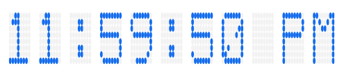

# Getting Started with WPF Digital Gauge (SfDigitalGauge)

This sample demonstrates how to create and configure a [Syncfusion WPF Digital Gauge (SfDigitalGauge)](https://www.syncfusion.com/wpf-controls/digital-gauge) with customizable characters and values.

## Table of Contents

- [Adding Gauge Reference](#adding-gauge-reference)
- [Initialize Gauge](#initialize-gauge)
- [Displaying Values](#displaying-values)
- [Setting Character Type](#setting-character-type)
- [Configuring Properties](#configuring-properties)
- [Output](#output)

---

## Adding Gauge Reference

Install the **Syncfusion.SfGauge.WPF** NuGet package into your WPF project.

**Package Reference in `.csproj`:**

```xml
<ItemGroup>
    <PackageReference Include="Syncfusion.SfGauge.WPF" Version="*" />
</ItemGroup>
```

---

## Initialize Gauge

Import the WPF Digital Gauge namespace in your `MainWindow.xaml`:

```xml
xmlns:gauge="clr-namespace:Syncfusion.UI.Xaml.Gauges;assembly=Syncfusion.SfGauge.Wpf"
```

Then initialize an empty `SfDigitalGauge` as shown below:

```xml
<gauge:SfDigitalGauge/>
```

---

## Displaying Values

The `SfDigitalGauge` control provides options to display special characters or values using the `Value` property:

```xml
<syncfusion:SfDigitalGauge Value="11:59:50 PM" />
```

---

## Setting Character Type

By using the `CharacterType` property, you can set the segments for the digital gauge:

```xml
<syncfusion:SfDigitalGauge Value="11:59:50 PM"              CharacterType="EightCrossEightDotMatrix"/>
```

The digital characters can be drawn in the following four different segment types:
- EightCrossEightDotMatrix
- SegmentFourteen
- SegmentSeven
- SegmentSixteen

---

## Configuring Properties

The `CharacterHeight`, `CharacterWidth`, and `CharacterStroke` properties are used to display characters, which can be customized:

```xml
<syncfusion:SfDigitalGauge CharacterHeight="60"             CharacterWidth="25" CharacterStroke="#146CED"/>
```

---

## Output

The following is the complete `MainWindow.xaml` combining all the above configurations:

```xml
<Window x:Class="GettingStarted.MainWindow"
        xmlns="http://schemas.microsoft.com/winfx/2006/xaml/presentation"
        xmlns:x="http://schemas.microsoft.com/winfx/2006/xaml"
        xmlns:d="http://schemas.microsoft.com/expression/blend/2008"
        xmlns:mc="http://schemas.openxmlformats.org/markup-compatibility/2006"
        xmlns:local="clr-namespace:GettingStarted"
        xmlns:gauge="clr-namespace:Syncfusion.UI.Xaml.Gauges;assembly=Syncfusion.SfGauge.Wpf"
        mc:Ignorable="d"
        Title="MainWindow"
        WindowState="Maximized">
    <Grid>
        <gauge:SfDigitalGauge Value="11:59:50 PM"
                              Height="100"
                              Width="375"
                              DimmedBrush="#F2F2F2"
                              CharacterHeight="60"
                              CharacterWidth="25"
                              HorizontalAlignment="Center"
                              VerticalAlignment="Center"
                              CharacterType="EightCrossEightDotMatrix"
                              CharacterStroke="#146CED" />
    </Grid>
</Window>
```

The gauge rendered as a result of the above code:



---

## Theme

`SfDigitalGauge` supports various built-in themes. Refer to the links below to apply themes:

- [Apply theme using SfSkinManager](https://help.syncfusion.com/wpf/themes/skin-manager)
- [Create a custom theme using ThemeStudio](https://help.syncfusion.com/wpf/themes/theme-studio#creating-custom-theme)

---

## See Also

- [WPF Digital Gauge Feature Tour](https://www.syncfusion.com/wpf-controls/digital-gauge)
- [WPF Digital Gauge Examples on GitHub](https://github.com/syncfusion/wpf-demos/tree/master/gauge)
- [How to apply themes for SfDigitalGauge](https://support.syncfusion.com/kb/article/2842/how-to-apply-themes-for-sfdigitalgauge)