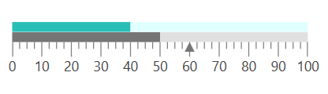

# Getting Started with WPF Linear Gauge (SfLinearGauge)

This sample demonstrates how to create and configure a [Syncfusion WPF Linear Gauge (SfLinearGauge)](https://www.syncfusion.com/wpf-controls/linear-gauge) with scales, ranges, and various pointer types.

## Table of Contents

- [Adding Gauge Reference](#adding-gauge-reference)
- [Initialize Gauge](#initialize-gauge)
- [Configure Scales](#configure-scales)
- [Add Ranges](#add-ranges)
- [Add Pointers](#add-pointers)
- [Output](#output)

---

## Adding Gauge Reference

Install the **Syncfusion.SfGauge.WPF** NuGet package into your WPF project.

**Package Reference in `.csproj`:**

```xml
<ItemGroup>
    <PackageReference Include="Syncfusion.SfGauge.WPF" Version="*" />
</ItemGroup>
```

---

## Initialize Gauge

Import the WPF Linear Gauge namespace in your `MainWindow.xaml`:

```xml
xmlns:gauge="clr-namespace:Syncfusion.UI.Xaml.Gauges;assembly=Syncfusion.SfGauge.Wpf"
```

Then initialize an empty `SfLinearGauge` as shown below:

```xml
<gauge:SfLinearGauge/>
```

---

## Configure Scales

You can configure the `LinearScale` elements:

```xml
<gauge:SfLinearGauge.MainScale>
    <gauge:LinearScale LabelStroke="#424242"
                       MajorTickStroke="Gray"
                       MajorTickSize="15"
                       MajorTickStrokeThickness="1"
                       MinorTickStroke="Gray"
                       MinorTickSize="7"
                       MinorTickStrokeThickness="1"
                       MinorTicksPerInterval="3"
                       ScaleBarStroke="#E0E0E0"
                       ScaleBarLength="300"
                       ScaleBarSize="10">
    </gauge:LinearScale>
</gauge:SfLinearGauge.MainScale>
```

---

## Add Ranges

You can add ranges to the `SfLinearGauge`:

```xml
<gauge:LinearScale.Ranges>
    <gauge:LinearRange StartValue="0"
                       EndValue="40"
                       RangeStroke="#27BEB7"
                       StartWidth="10"
                       EndWidth="10"
                       RangeOffset="0.4" />
    <gauge:LinearRange StartValue="40"
                       EndValue="100"
                       RangeStroke="LightCyan"
                       RangeOffset="0.4"
                       StartWidth="10"
                       EndWidth="10" />
</gauge:LinearScale.Ranges>
```

---

## Add Pointers

Create different types of pointers to indicate values:

```xml
<gauge:LinearScale.Pointers>
    <gauge:LinearPointer PointerType="SymbolPointer"
                         Value="60"
                         SymbolPointerHeight="10"
                         SymbolPointerWidth="10"
                         SymbolPointerPosition="Below"
                         SymbolPointerStroke="#757575" />
    <gauge:LinearPointer PointerType="BarPointer"
                         Value="50"
                         BarPointerStroke="#757575"
                         BarPointerStrokeThickness="10" />
</gauge:LinearScale.Pointers>
```

---

## Output

The following is the complete `MainWindow.xaml` combining all the above configurations:

```xml
<Window x:Class="Gauge_GettingStarted.MainWindow"
        xmlns="http://schemas.microsoft.com/winfx/2006/xaml/presentation"
        xmlns:x="http://schemas.microsoft.com/winfx/2006/xaml"
        xmlns:d="http://schemas.microsoft.com/expression/blend/2008"
        xmlns:mc="http://schemas.openxmlformats.org/markup-compatibility/2006"
        xmlns:local="clr-namespace:Gauge_GettingStarted"
        mc:Ignorable="d"
        xmlns:gauge="clr-namespace:Syncfusion.UI.Xaml.Gauges;assembly=Syncfusion.SfGauge.Wpf">

    <Grid>
        <gauge:SfLinearGauge>
            <gauge:SfLinearGauge.MainScale>
                <gauge:LinearScale LabelStroke="#424242"
                                   MajorTickStroke="Gray"
                                   MajorTickSize="15"
                                   MajorTickStrokeThickness="1"
                                   MinorTickStroke="Gray"
                                   MinorTickSize="7"
                                   MinorTickStrokeThickness="1"
                                   MinorTicksPerInterval="3"
                                   ScaleBarStroke="#E0E0E0"
                                   ScaleBarLength="300"
                                   ScaleBarSize="10">

                    <gauge:LinearScale.Pointers>
                        <gauge:LinearPointer PointerType="SymbolPointer"
                                             Value="60"
                                             SymbolPointerHeight="10"
                                             SymbolPointerWidth="10"
                                             SymbolPointerPosition="Below"
                                             SymbolPointerStroke="#757575" />
                        <gauge:LinearPointer PointerType="BarPointer"
                                             Value="50"
                                             BarPointerStroke="#757575"
                                             BarPointerStrokeThickness="10" />
                    </gauge:LinearScale.Pointers>

                    <gauge:LinearScale.Ranges>
                        <gauge:LinearRange StartValue="0"
                                           EndValue="40"
                                           RangeStroke="#27BEB7"
                                           StartWidth="10"
                                           EndWidth="10"
                                           RangeOffset="0.4" />
                        <gauge:LinearRange StartValue="40"
                                           EndValue="100"
                                           RangeStroke="LightCyan"
                                           RangeOffset="0.4"
                                           StartWidth="10"
                                           EndWidth="10" />
                    </gauge:LinearScale.Ranges>
                </gauge:LinearScale>
            </gauge:SfLinearGauge.MainScale>
        </gauge:SfLinearGauge>
    </Grid>
</Window>
```

The gauge rendered as a result of the above code:



---

## Theme

`SfLinearGauge` supports various built-in themes. Refer to the links below to apply themes:

- [Apply theme using SfSkinManager](https://help.syncfusion.com/wpf/themes/skin-manager)
- [Create a custom theme using ThemeStudio](https://help.syncfusion.com/wpf/themes/theme-studio#creating-custom-theme)

---

## See Also

- [WPF Linear Gauge Feature Tour](https://www.syncfusion.com/wpf-controls/linear-gauge)
- [WPF Linear Gauge Examples on GitHub](https://github.com/syncfusion/wpf-demos/tree/master/gauge)
- [How to apply themes for SfLinearGauge](https://support.syncfusion.com/kb/article/2841/how-to-apply-themes-for-sflineargauge)