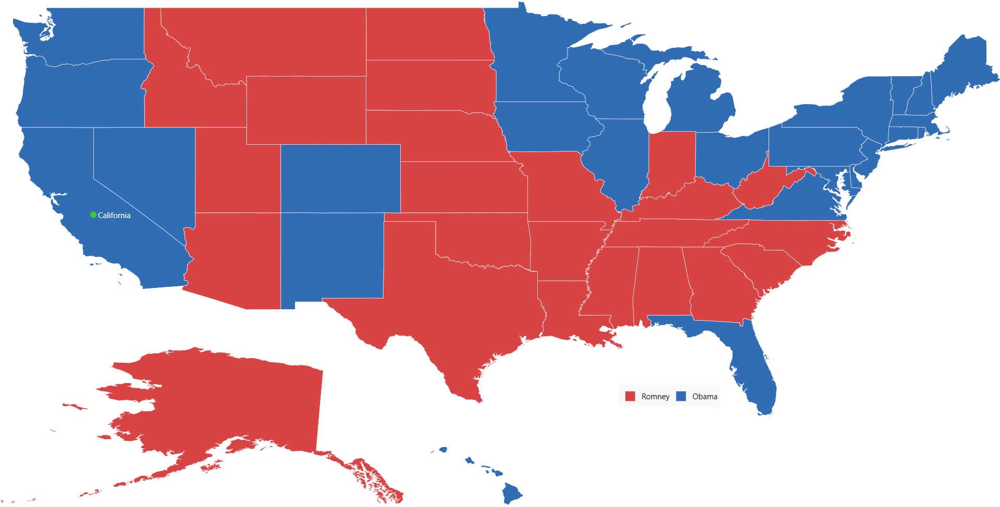

# Getting Started with WPF Maps (SfMap)

This sample demonstrates how to create and configure a [Syncfusion WPF Maps (SfMap)](https://www.syncfusion.com/wpf-controls/map) with shape file layers, data binding, markers, and color mapping.

## Table of Contents

- [Prerequisites](#prerequisites)
- [Adding Map Reference](#adding-map-reference)
- [Initialize Map](#initialize-map)
- [Initialize View Model](#initialize-view-model)
- [Add Shape File Layer](#add-shape-file-layer)
- [Data Binding](#data-binding)
- [Add Markers](#add-markers)
- [Color Mapping](#color-mapping)
- [Add Legends](#add-legends)
- [Output](#output)

---

## Prerequisites

- Visual Studio 2022 or later
- .NET Framework 4.8 or later
- Syncfusion NuGet packages

---

## Adding Map Reference

Install the **Syncfusion.SfMaps.WPF** NuGet package into your WPF project.

**Package Reference in `.csproj`:**

```xml
<ItemGroup>
    <PackageReference Include="Syncfusion.SfMaps.WPF" Version="*" />
</ItemGroup>
```

---

## Initialize Map

Import the WPF Maps namespace in your `MainWindow.xaml`:

```xml
xmlns:syncfusion="http://schemas.syncfusion.com/wpf"
```

Then initialize an empty `SfMap` as shown below:

```xml
<syncfusion:SfMap />
```

---

## Initialize View Model

Define data models that represent the data points in the map.

**ElectionData.cs**

```csharp
namespace GettingStarted
{
 public class ElectionData
    {
        private string state;
        public string State
        {
            get { return state; }
            set { state = value; }
        }

        public string candidate;
        public string Candidate
        {
            get { return candidate; }
            set { candidate = value; }
        }

        private double electors;
        public double Electors
        {
            get { return electors; }
            set { electors = value; }
        }
    }
}
```

**Model.cs**

```csharp
namespace GettingStarted
{
    public class Model
    {
        public string Label { get; set; }
        public string Longitude { get; set; }
        public string Latitude { get; set; }
    }
}
```

Next, create a `ViewModel` class and initialize collections of data:

**ViewModel.cs**

```csharp
using System.Collections.ObjectModel;

namespace GettingStarted
{
    public class ViewModel
    {
        public ObservableCollection<ElectionData> ElectionResults { get; set; }
        public ObservableCollection<Model> Models { get; set; }

        public ViewModel()
        {
            ElectionResults = new ObservableCollection<ElectionData>
            {
                new ElectionData { State = "Alabama", Candidate = "Romney", Electors = 9 },
                new ElectionData { State = "Alaska", Candidate = "Romney", Electors = 3 },
                // ... more data entries
                new ElectionData { State = "Wyoming", Candidate = "Romney", Electors = 3 }
            };

            this.Models = new ObservableCollection<Model>
            {
                new Model() { Label = "California", Latitude = "37", Longitude = "-120" }
            };
        }
    }
}
```

Set the `ViewModel` instance as the `DataContext` of your window in XAML:

```xml
<Window x:Class="GettingStarted.MainWindow"
        xmlns="http://schemas.microsoft.com/winfx/2006/xaml/presentation"
        xmlns:x="http://schemas.microsoft.com/winfx/2006/xaml"
        xmlns:local="clr-namespace:GettingStarted"
        xmlns:syncfusion="http://schemas.syncfusion.com/wpf"
        Title="MapGettingStarted"
        WindowState="Maximized">

    <Grid>
        <Grid.DataContext>
            <local:ViewModel />
        </Grid.DataContext>
    </Grid>
</Window>
```

---

## Add Shape File Layer

Add a `ShapeFileLayer` to `SfMap.Layers` and specify the shape file path:

```xml
<syncfusion:SfMap>
    <syncfusion:SfMap.Layers>
        <syncfusion:ShapeFileLayer Uri="GettingStarted.ShapeFiles.usa_state.shp">
        </syncfusion:ShapeFileLayer>
    </syncfusion:SfMap.Layers>
</syncfusion:SfMap>
```

---

## Data Binding

Bind data to the shape file layer using `ItemsSource`, `ShapeIDPath`, and `ShapeIDTableField` properties:

```xml
<syncfusion:ShapeFileLayer ItemsSource="{Binding ElectionResults}"
                           ShapeIDPath="State"
                           ShapeIDTableField="STATE_NAME"
                           Uri="GettingStarted.ShapeFiles.usa_state.shp">
    <syncfusion:ShapeFileLayer.ShapeSettings>
        <syncfusion:ShapeSetting ShapeValuePath="Electors" />
    </syncfusion:ShapeFileLayer.ShapeSettings>
</syncfusion:ShapeFileLayer>
```

---

## Add Markers

Markers can be added to the shape file layer to identify specific locations:

```xml
<syncfusion:ShapeFileLayer Markers="{Binding Models}"
                           MarkerIconFill="LimeGreen"
                           MarkerLabelForeground="White">
</syncfusion:ShapeFileLayer>
```

---

## Color Mapping

Customize shape colors based on the underlying data values:

```xml
<syncfusion:ShapeSetting.ShapeColorValuePath="Candidate">
    <syncfusion:ShapeSetting.FillSetting>
        <syncfusion:ShapeFillSetting AutoFillColors="False">
            <syncfusion:ShapeFillSetting.ColorMappings>
                <syncfusion:EqualsColorMapping Value="Romney"
                                               Color="#D84444" />
                <syncfusion:EqualsColorMapping Value="Obama"
                                               Color="#316DB5" />
            </syncfusion:ShapeFillSetting.ColorMappings>
        </syncfusion:ShapeFillSetting>
    </syncfusion:ShapeSetting.FillSetting>
</syncfusion:ShapeSetting>
```

---

## Add Legends

Legends interpret what the map displays and can be added to the shape file layer:

```xml
<syncfusion:ShapeFileLayer LegendColumnSplit="2"
                           LegendPositionX="950"
                           LegendPositionY="580"
                           LegendVisibility="Visible"
                           LegendIcon="Rectangle">
</syncfusion:ShapeFileLayer>
```

---

## Output

The following is the complete `MainWindow.xaml` combining all the above configurations:

```xml
<Window x:Class="GettingStarted.MainWindow"
        xmlns="http://schemas.microsoft.com/winfx/2006/xaml/presentation"
        xmlns:x="http://schemas.microsoft.com/winfx/2006/xaml"
        xmlns:d="http://schemas.microsoft.com/expression/blend/2008"
        xmlns:mc="http://schemas.openxmlformats.org/markup-compatibility/2006"
        xmlns:local="clr-namespace:GettingStarted"
        xmlns:syncfusion="http://schemas.syncfusion.com/wpf"
        mc:Ignorable="d"
        Title="MapGettingStarted"
        WindowState="Maximized">

    <Grid>
        <Grid.DataContext>
            <local:ViewModel />
        </Grid.DataContext>

        <syncfusion:SfMap x:Name="map"
                          EnableZoom="False"
                          EnablePan="False">
            <syncfusion:SfMap.Layers>
                <syncfusion:ShapeFileLayer x:Name="shapeLayer"
                                           Background="White"
                                           EnableSelection="True"
                                           Uri="GettingStarted.ShapeFiles.usa_state.shp"
                                           ItemsSource="{Binding ElectionResults}"
                                           MapItemsVisibility="Hidden"
                                           ShapeIDPath="State"
                                           ShapeIDTableField="STATE_NAME"
                                           
                                           Markers="{Binding Models}"
                                           MarkerIconFill="LimeGreen"
                                           MarkerLabelForeground="White"
                                           
                                           LegendColumnSplit="2"
                                           LegendPositionX="950"
                                           LegendPositionY="580"
                                           LegendVisibility="Visible"
                                           LegendIcon="Rectangle">

                    <syncfusion:ShapeFileLayer.ShapeSettings>
                        <syncfusion:ShapeSetting ShapeFill="#E5E5E5"
                                                 ShapeStroke="White"
                                                 ShapeStrokeThickness="0.5"
                                                 SelectedShapeColor="#CEBF93"
                                                 ShapeValuePath="Electors"
                                                 ShapeColorValuePath="Candidate">
                            <syncfusion:ShapeSetting.FillSetting>
                                <syncfusion:ShapeFillSetting AutoFillColors="False">
                                    <syncfusion:ShapeFillSetting.ColorMappings>
                                        <syncfusion:EqualsColorMapping Value="Romney"
                                                                       Color="#D84444" />
                                        <syncfusion:EqualsColorMapping Value="Obama"
                                                                       Color="#316DB5" />
                                    </syncfusion:ShapeFillSetting.ColorMappings>
                                </syncfusion:ShapeFillSetting>
                            </syncfusion:ShapeSetting.FillSetting>
                        </syncfusion:ShapeSetting>
                    </syncfusion:ShapeFileLayer.ShapeSettings>
                </syncfusion:ShapeFileLayer>
            </syncfusion:SfMap.Layers>
        </syncfusion:SfMap>
    </Grid>
</Window>
```

The map rendered as a result of the above code:



---

## Theme

`SfMap` supports various built-in themes. Refer to the links below to apply themes:

- [Apply theme using SfSkinManager](https://help.syncfusion.com/wpf/themes/skin-manager)
- [Create a custom theme using ThemeStudio](https://help.syncfusion.com/wpf/themes/theme-studio#creating-custom-theme)

---

## See Also

- [WPF Maps Feature Tour](https://www.syncfusion.com/wpf-controls/map)
- [WPF Maps Examples on GitHub](https://github.com/syncfusion/wpf-demos/tree/master/map)
- [How to show google map in WPF SfMap](https://www.syncfusion.com/kb/11928/how-to-show-google-map-in-wpf-map-sfmap)
- [How to view bing map using WPF SfMap](https://www.syncfusion.com/kb/10799/how-to-view-bing-map-using-wpf-map-control-sfmap)
- [How to render custom data source in SfMap](https://www.syncfusion.com/kb/3237/how-to-render-customdatasource-in-sfmap)